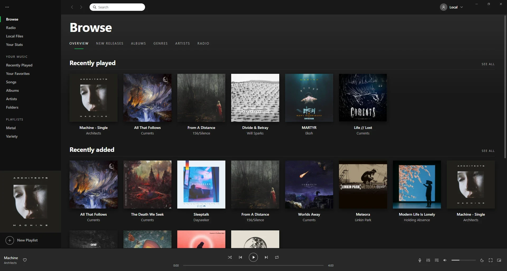
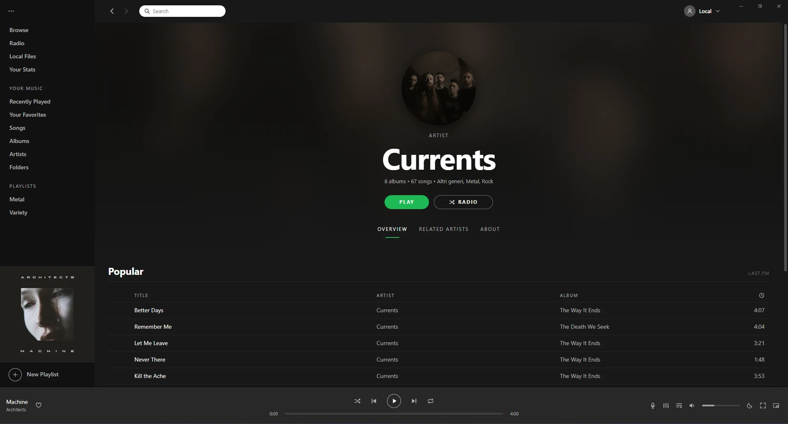
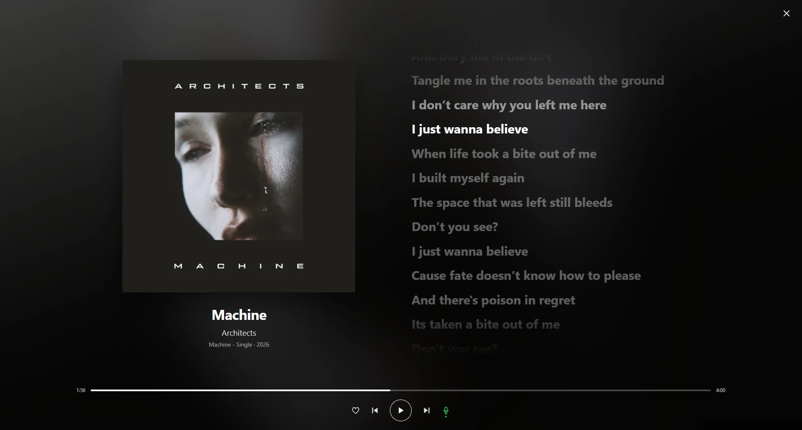

<div align="center">


# Wax

**Your own music, in the Spotify you remember.**

The classic 2015–2017 Spotify desktop look · for the files on your computer · no streaming, no account

[](https://github.com/TonyMontania/Wax/releases/latest)

[](https://github.com/TonyMontania/Wax/releases/latest)
[](https://github.com/TonyMontania/Wax/releases/latest)
[](https://github.com/TonyMontania/Wax/releases)
[](https://github.com/TonyMontania/Wax/actions/workflows/build.yml)
[](LICENSE)


[](https://tauri.app/)
[](https://github.com/TonyMontania/Wax/stargazers)

</div>

- **The old Spotify, for your files** — Browse, Radio, Your Music, artist pages with Popular and Related Artists, the lyrics column.
- **Sounds right** — its own Rust audio engine: gapless, crossfade, ReplayGain, 10-band EQ, AutoEQ for your headphones, WASAPI exclusive mode.
- **Takes care of your library** — tags, covers, synced lyrics, duplicates, organizing files, CUE sheets, Last.fm.
- **Yours, offline** — no accounts, no cloud, no telemetry. Your library stays in your folders; Wax keeps a few JSON files you own.

<p align="center">
  
</p>

## Contents

- [Install](#install)
- [See it in action](#see-it-in-action)
- [Why Wax?](#why-wax)
- [Features](#features)
- [Your music folder](#your-music-folder)
- [Online services](#online-services)
- [Storage](#storage)
- [Keyboard shortcuts](#keyboard-shortcuts)
- [Privacy](#privacy)
- [Credits](#credits)
- [License](#license)

## Install

| OS | Quickest way |
| --- | --- |
| **Windows** | [`-setup.exe` installer](https://github.com/TonyMontania/Wax/releases/latest) — or the portable `.zip` |
| **macOS** | [`.dmg`](https://github.com/TonyMontania/Wax/releases/latest) — one build for Apple Silicon and Intel |
| **Linux** | [`.AppImage`](https://github.com/TonyMontania/Wax/releases/latest), `.deb` or `.rpm` |

Builds are unsigned, so Windows SmartScreen and macOS Gatekeeper show a one-time warning on first launch. Details for every package are below.

<details>
<summary><b>Windows — all packages</b></summary>

| Package | File | Command | Notes |
| --- | --- | --- | --- |
| **Installer** | `Wax_<version>_x64-setup.exe` | double-click | For your user (no admin) or for everyone, in any folder or drive. Recommended. |
| **Portable ZIP** | `Wax-portable-<version>-win64.zip` | extract, run `Wax.exe` | Anywhere: a folder, another drive, a USB stick. Windows 10 21H2+ and Windows 11 already have WebView2; on older builds install the [Evergreen runtime](https://developer.microsoft.com/microsoft-edge/webview2/) once. |

Data lives under `%APPDATA%\Wax\` (the portable build keeps it in `data\` next to `Wax.exe`).

</details>

<details>
<summary><b>macOS — all packages</b></summary>

| Package | File | Command | Notes |
| --- | --- | --- | --- |
| **DMG** | `Wax_<version>_universal.dmg` | drag to Applications | Universal: M1 / M2 / M3 / M4 and Intel Macs. macOS 10.15+. |

First launch on macOS 14 Sonoma or earlier: right-click **Open** → **Open**. On macOS 15 Sequoia the right-click bypass is gone, so run once from the Terminal:

```bash
xattr -cr /Applications/Wax.app
open /Applications/Wax.app
```

The `xattr -cr` clears the quarantine flag Gatekeeper set on the download.

Data lives under `~/Library/Application Support/Wax/`.

</details>

<details>
<summary><b>Linux — all packages</b></summary>

| Package | File | Command | Notes |
| --- | --- | --- | --- |
| **AppImage** | `Wax_<version>_amd64.AppImage` | `chmod +x Wax_<version>_amd64.AppImage && ./Wax_<version>_amd64.AppImage` | Universal, updates itself. Debian / Ubuntu 22.04+ need `libfuse2` (`sudo apt install libfuse2`). No FUSE? Run with `--appimage-extract-and-run`. |
| **Debian package** | `Wax_<version>_amd64.deb` | `sudo apt install ./Wax_<version>_amd64.deb` | Debian, Ubuntu, Mint, Pop!_OS, elementary. |
| **RPM package** | `Wax-<version>-1.x86_64.rpm` | `sudo dnf install ./Wax-<version>-1.x86_64.rpm` | Fedora, RHEL, Rocky, Alma, openSUSE. |

Data lives under `~/.local/share/wax/`.

</details>

**Updates** — Settings → About checks GitHub Releases (and once a day on its own) and installs the new version in the same place Wax is: the portable folder, the install folder, `Wax.app` or the AppImage. `.deb` / `.rpm` updates are handed to your system's installer.

Building from source? See [CONTRIBUTING.md → Running locally](CONTRIBUTING.md#running-locally).

## See it in action



*Artist page — the artist's photo, Popular songs ranked by Last.fm, Related Artists and About tabs, and every album below.*



*Full-screen Now Playing (F11) — big cover, a background tinted by the album art and synced lyrics that follow the song.*

## Why Wax?

| | Streaming apps | Classic local players | **Wax** |
| --- | :---: | :---: | :---: |
| Plays the files you own (FLAC, MP3, CUE…) | — | ✓ | ✓ |
| The classic Spotify look and flow | ✓ | — | ✓ |
| Artist pages: Popular, Related Artists, bio | ✓ | Rarely | ✓ (Last.fm) |
| Synced lyrics | ✓ | Plugins | ✓ (LRCLIB, .lrc) |
| Gapless, ReplayGain, EQ, exclusive mode | Partly | ✓ | ✓ |
| Fixes your tags, covers and folders | — | Varies | ✓ |
| Works offline, no account | — | ✓ | ✓ |
| Free and open source | — | Varies | ✓ |

## Features

<table>
<tr>
<td width="33%" valign="top">

**Listen**

- **Own audio engine** in Rust (symphonia): MP3, FLAC, OGG, M4A/AAC, ALAC, WAV, AIFF; OPUS through the WebView
- **Gapless** playback (encoder silence trimmed) and **crossfade** 0–12 s, skipped inside live / concept albums
- **ReplayGain** from tags or Wax's own **EBU R128** analysis (track / album), preamp, clipping protection
- **10-band equalizer** with presets, **AutoEQ** for ~9,000 headphones, **crossfeed**
- **Output device** picker and **WASAPI exclusive mode**
- High-quality resampling and a 3 s decode buffer: no stutter, no harsh highs
- **CUE sheets** — one-file albums split into sample-exact, gapless tracks
- **Synced lyrics** column (LRCGET `.lrc`, embedded, LRCLIB) and **full-screen Now Playing** (F11)
- **Auto DJ**, artist **Radio**, **sleep timer**, mini player

</td>
<td width="33%" valign="top">

**Your library**

- **Artists = your artist folders** — guests never clutter the list
- **Browse, Albums, Songs, Genres, Folders**, Recently Played, Favorites, **ratings**
- **Playlists** with folders, images, descriptions, drag & drop, M3U import / export
- **Import Spotify playlists** (Exportify CSV) — rebuilt with your files
- **Edit tags** in bulk, **MusicBrainz** fill-in, **tags from file names**, **fix capitalization**, **credits**
- **Covers & artist photos** — local, Deezer, or pick your own; embed in bulk
- **Organize files** with saved patterns — and **undo**
- **Library check** — missing covers, lyrics, years, track numbers, genres, ReplayGain, with one-click fixes
- **Duplicates** — keeps the best copy, moves the rest to the Recycle Bin
- **Copy to a USB stick / phone**, optionally converting to MP3
- New music is picked up as soon as you copy it

</td>
<td width="33%" valign="top">

**Discover & desktop**

- **Last.fm** — scrobbling, Popular songs, Related Artists, bios, album notes, tags as genres, ♥ ↔ Loved tracks, import your history
- **ListenBrainz** scrobbling (queued when offline)
- **New Releases** from your artists you don't own yet
- **Your Stats** and a yearly **Wrapped**
- **Search inside lyrics**
- **Media keys**, Windows media panel, taskbar ⏮ ⏯ ⏭ buttons
- **Tray**, **global shortcuts**, song-change notification
- **Discord** "Listening to" status
- **Start with Windows** (or macOS / Linux login), Start-menu shortcut
- **8 accent colors**
- **In-app updater** — installs where Wax lives
- **Portable or installed**, your choice

</td>
</tr>
</table>

## Your music folder

Wax expects this layout inside each music folder you add:

```
Music/
  Artist/
    Album or EP/
      01 - Song.flac
      cover.jpg          ← optional (or embedded in the files)
    Singles/             ← loose singles work too
      Song.mp3
  Another Artist/
    …/Album.flac + Album.cue   ← one-file albums with a CUE sheet
```

- **Artists** are the artist folders: every song belongs to its folder's artist, whatever the tags say; "feat." guests and collaborations link to existing artists but never create new ones.
- **Artist photos**: `artist.jpg` / `folder.jpg` in the artist's folder, otherwise Deezer — or choose one (right-click the artist).
- **Lyrics**: `Song.lrc` / `Song.txt` next to the file (what [LRCGET](https://github.com/tranxuanthang/lrcget) downloads), embedded lyrics, or LRCLIB.

## Online services

Everything online is optional. Keys (only for the services that need them) go in **Settings**.

| Service | What it's for | Auth |
| --- | --- | --- |
| [Deezer](https://www.deezer.com/) | Missing album covers, artist photos, cover picker, New Releases | No key |
| [MusicBrainz](https://musicbrainz.org/) | Fill in album tags (titles, artists, numbers, year, genres), song credits | No key |
| [LRCLIB](https://lrclib.net/) | Lyrics, synced when available | No key |
| [Last.fm](https://www.last.fm/) | Scrobbling, Popular songs, Related Artists, bios, tags, Loved tracks, history import | Free API key (step-by-step guide inside Wax) |
| [ListenBrainz](https://listenbrainz.org/) | Scrobbling | User token |
| [AutoEQ](https://github.com/jaakkopasanen/AutoEq) | Headphone correction profiles | No key |
| [Discord](https://discord.com/developers/applications) | "Listening to" status | Your own application ID (guide inside Wax) |
| [GitHub Releases](https://github.com/TonyMontania/Wax/releases) | Update check | No key |

## Storage

Your music is never moved or changed unless you ask (tag editing, organizing, embedding). Wax's own data lives in the OS's app data folder — or in `data/` next to the program for the portable build:

```
state.json            ← folders, playlists, favorites, ratings, settings, EQ, shortcuts
library.json          ← library cache: rescans only re-read files that changed
history.jsonl         ← every play (Your Stats, Wrapped)
loudness.json         ← R128 loudness analysis
scrobble_queue.json   ← plays waiting to be sent while offline
covers/               ← "Architects - Machine - Single.jpg" (+ " (large)"), index.json
artists/              ← "Currents.jpg" … (images you choose replace the ones found)
playlists/            ← playlist images
lyrics/               ← "Architects - Machine.json": LRCLIB answers
lastfm/  cache/       ← Last.fm, Deezer, MusicBrainz and AutoEQ answers, named after what they're about
```

Settings → About opens the program folder and the data folder.

## Keyboard shortcuts

- **Space** — play / pause
- **Ctrl+← / →** — previous / next · **Ctrl+↑ / ↓** — volume
- **Ctrl+F** — filter the current list / search
- **Ctrl+A**, **Shift / Ctrl+click** — select several songs
- **Alt+← / →** — back / forward
- **F11** — full-screen Now Playing · **Esc** — close it
- **Right-click** — quick actions on any song, album, artist or playlist
- **Global** (work while Wax is in the background, configurable): Ctrl+Alt+P play / pause, Ctrl+Alt+← / → previous / next, Ctrl+Alt+↑ / ↓ volume, Ctrl+Alt+L favorite, Ctrl+Alt+W show Wax, Ctrl+Alt+M mini player

## Privacy

- **No accounts, no telemetry, no analytics.** Nothing is sent home.
- **Outbound requests only for the services above** — and each can be turned off in Settings. The update check against GitHub Releases runs once a day (can be turned off too).
- **Keys and tokens** you paste (Last.fm, ListenBrainz, Discord) live in `state.json` on your disk and are only sent to that service.

## Credits

- Audio: [symphonia](https://github.com/pdeljanov/Symphonia), [rodio](https://github.com/RustAudio/rodio) / [cpal](https://github.com/RustAudio/cpal), [rubato](https://github.com/HEnquist/rubato), [wasapi](https://github.com/HEnquist/wasapi-rs), [ebur128](https://github.com/sdroege/ebur128), [LAME](https://lame.sourceforge.io/) for MP3 conversion
- Tags: [lofty](https://github.com/Serial-ATA/lofty-rs) · App: [Tauri](https://tauri.app/)
- Headphone profiles: [AutoEQ](https://github.com/jaakkopasanen/AutoEq) by Jaakko Pasanen · Lyrics: [LRCLIB](https://lrclib.net/)
- The look is a tribute to the 2015–2017 Spotify desktop app. Wax isn't affiliated with Spotify.

## License

[GPL-3.0](LICENSE) — free to use, study, share and modify; modified versions you distribute stay open source too. The program includes LAME (LGPL).

---

<div align="center">

**If Wax is useful to you, a ⭐ on the repo helps other people find it.**

</div>

- Bugs / feature requests → [issues](https://github.com/TonyMontania/Wax/issues)
- Building from source / contributing → [CONTRIBUTING.md](CONTRIBUTING.md)
- Changelog → [releases page](https://github.com/TonyMontania/Wax/releases)
